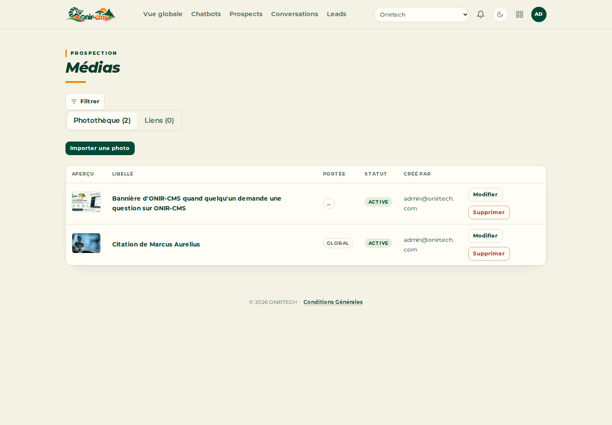
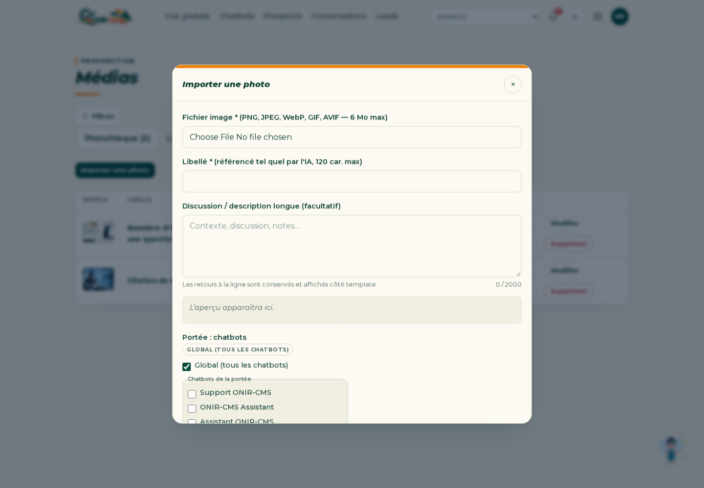
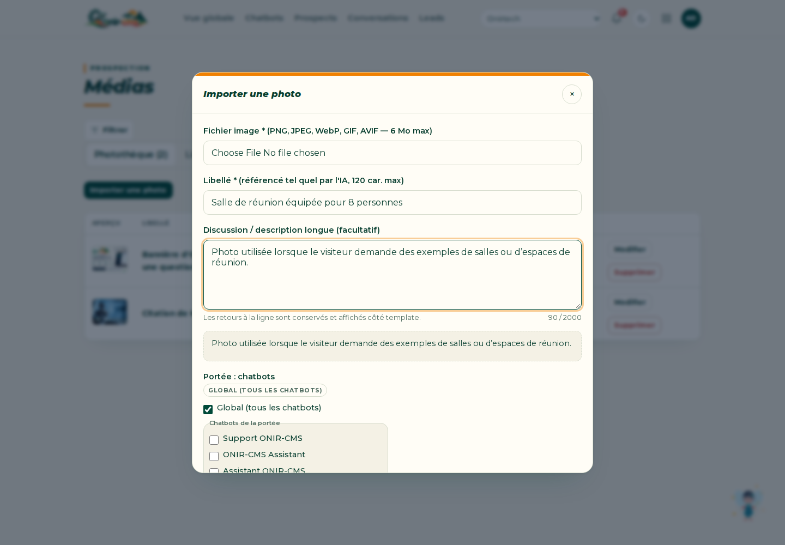

Une image ne sert pas seulement à illustrer une réponse : elle peut devenir une ressource à part entière pour votre assistant IA. Encore faut-il lui donner un **libellé compréhensible** et une **portée** cohérente.

Dans ce tutoriel, nous ajoutons des images à la médiathèque d’ONIR-CMS, puis nous expliquons comment l’IA décide de les utiliser.

Les captures ci-dessous utilisent l’environnement de préproduction : [preprod-cms.onirtech.com](https://preprod-cms.onirtech.com/).

## Étape 1 — Ouvrir la médiathèque

Depuis **Médias**, vérifiez que vous êtes bien dans l’onglet **Photothèque**, puis cliquez sur **Importer une photo**.

## Étape 2 — Choisir le fichier

ONIR-CMS accepte les formats **PNG, JPEG, WebP, GIF et AVIF**, dans la limite de **6 Mo**.

Choisissez une image nette, lisible et directement utile pour votre activité. Une photo floue ou trop générique aura peu de chances d’être sélectionnée au bon moment.

## Étape 3 — Rédiger un libellé réellement utile

Le **libellé** est la première référence utilisée par l’IA pour comprendre le contenu de l’image et décider quand l’afficher.

Pour cet exemple, nous utilisons :

> Salle de réunion équipée pour 8 personnes

### Pourquoi le libellé est décisif

Comparez :

- ❌ `IMG_2043`
- ❌ `photo 1`
- ❌ `image`
- ✅ `Salle de réunion équipée pour 8 personnes`
- ✅ `Bannière ONIR-CMS affichée pour une question sur les chatbots`

Un libellé comme `IMG_2043` n’apprend rien à l’IA. Elle ne peut pas savoir qu’il s’agit d’une salle, d’un produit, d’une équipe ou d’une référence client.

À l’inverse, un libellé qui décrit **l’objet, le contexte et l’usage** permet à l’IA de rapprocher l’image d’une question du visiteur.

### Les bons réflexes

- décrivez ce que l’on voit réellement ;
- utilisez le vocabulaire de vos clients ;
- évitez les noms de fichiers et les termes génériques ;
- soyez précis mais court ;
- mettez à jour le libellé si l’image change.

## Étape 4 — Ajouter du contexte

La **description longue** est facultative. Elle peut préciser :

- le contexte de la photo ;
- le moment où elle est pertinente ;
- les éléments importants à ne pas confondre.

Exemple :

> Photo utilisée lorsque le visiteur demande des exemples de salles ou d’espaces de réunion.

Le libellé reste la référence principale. La description vient l’enrichir, pas le remplacer.

## Étape 5 — Choisir la portée

Deux options :

- **Global** : l’image est disponible pour tous les chatbots de l’organisation ;
- **Chatbots de la portée** : vous sélectionnez uniquement les assistants concernés.

Pour une image métier spécifique, préférez une portée limitée afin d’éviter qu’un autre assistant l’utilise hors contexte.

Vérifiez également que la case **Active** est cochée.

## Étape 6 — Importer et vérifier

Cliquez sur **Importer**.

L’image apparaît ensuite dans la photothèque avec :

- son aperçu ;
- son libellé ;
- sa portée ;
- son statut **ACTIVE** ;
- son créateur.

Si le statut est **inactive**, l’IA ne pourra pas l’utiliser.

## Étape 7 — Tester dans le chatbot

Ouvrez le chatbot concerné et posez une question qui correspond au libellé.

Exemple :

> Est-ce que vous avez des salles de réunion pour huit personnes ?

Si l’image est correctement libellée, visible et dans la portée du chatbot, l’assistant peut la proposer comme illustration pertinente.

## À retenir

Le libellé n’est pas un détail administratif : c’est **la fiche d’identité de l’image pour l’IA**.

Une image bien nommée, décrite et rattachée au bon chatbot devient une ressource fiable. Une image nommée `IMG_2043` restera invisible ou sera mal utilisée, même si son contenu est excellent.
