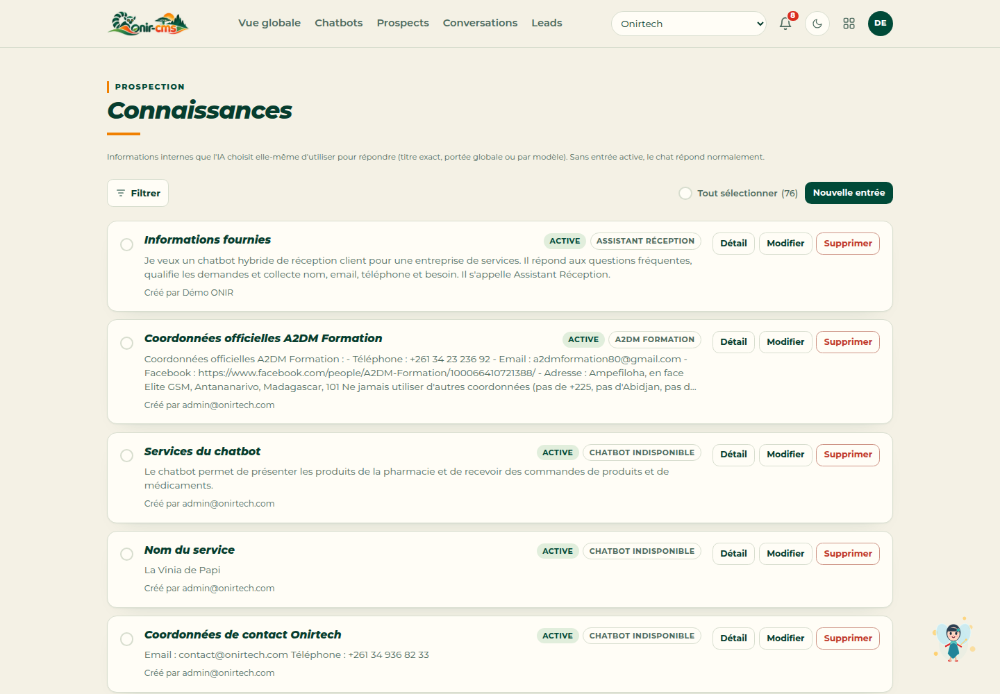
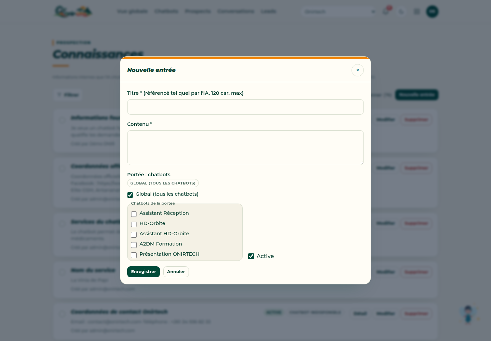
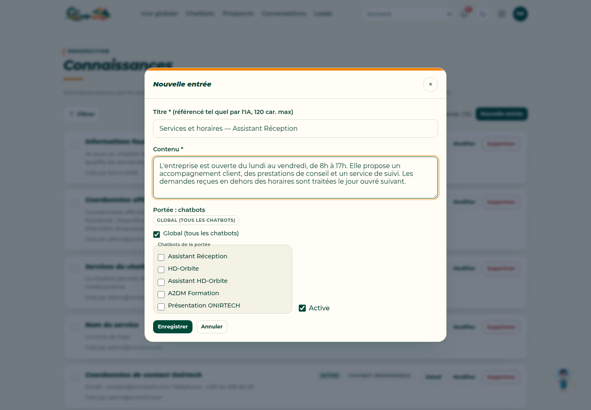
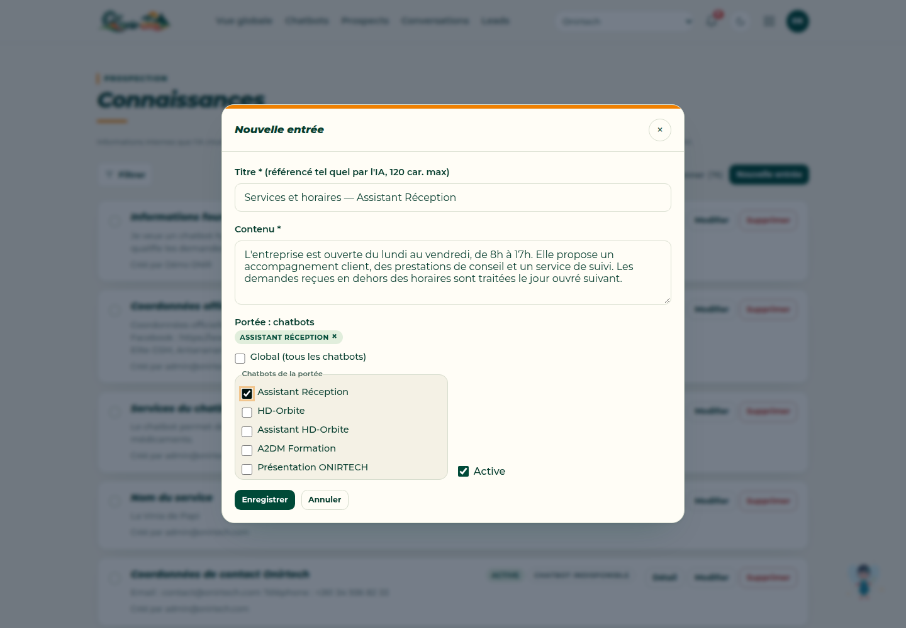
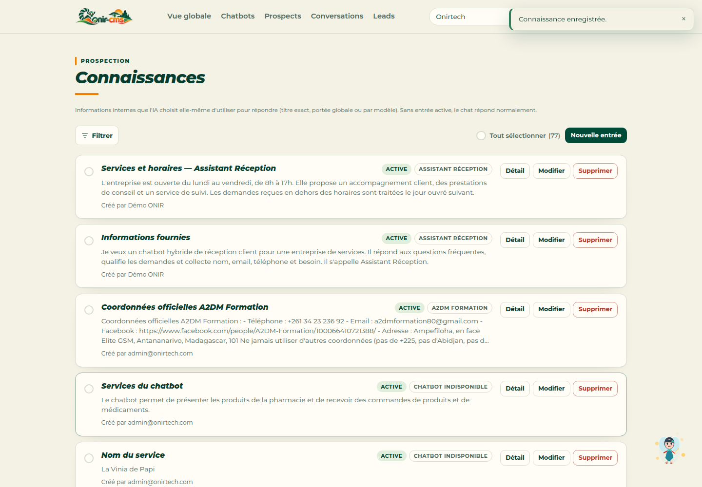
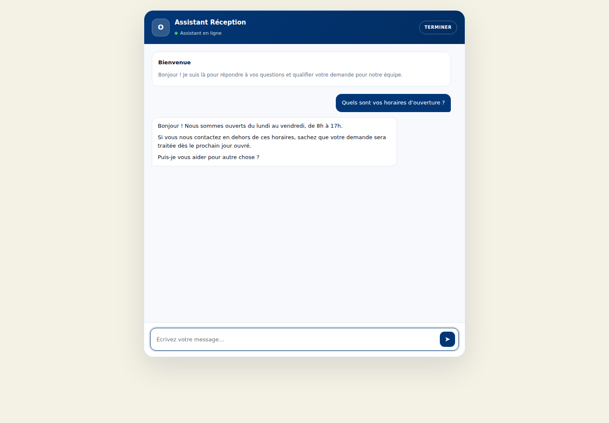

Un chatbot devient réellement utile lorsqu’il dispose d’informations fiables sur votre activité. ONIR-CMS permet d’ajouter ces informations sous forme de connaissances, puis de choisir les chatbots qui peuvent les utiliser.

Dans ce tutoriel, nous ajoutons une connaissance sur les services et horaires d’une entreprise, puis nous la rattachons à un chatbot de réception client.

## Étape 1 — Ouvrir les connaissances

Depuis **Connaissances**, cliquez sur **Nouvelle entrée**. La page liste toutes les informations internes disponibles pour l’organisation.

## Étape 2 — Créer une nouvelle connaissance

Le formulaire demande un **titre** et un **contenu**. Le titre est important : c’est la référence exacte que l’IA utilisera pour retrouver l’information.

## Étape 3 — Rédiger une information claire

Pour cet exemple, nous ajoutons les horaires et les services proposés :

> L’entreprise est ouverte du lundi au vendredi, de 8h à 17h. Elle propose un accompagnement client, des prestations de conseil et un service de suivi. Les demandes reçues en dehors des horaires sont traitées le jour ouvré suivant.

## Étape 4 — Choisir la portée

Deux possibilités :

- **Global** : la connaissance est disponible pour tous les chatbots de l’organisation ;
- **Chatbots de la portée** : vous sélectionnez un ou plusieurs chatbots précis.

Ici, nous choisissons **Assistant Réception** et laissons la connaissance **Active**.

## Étape 5 — Enregistrer et vérifier

Après **Enregistrer**, la connaissance apparaît dans la liste avec :

- le badge **ACTIVE** ;
- le chatbot associé ;
- le contenu ;
- le créateur.

## Bonnes pratiques

- Utilisez un **titre explicite** et stable.
- Écrivez des informations courtes et factuelles.
- Évitez de mélanger plusieurs sujets dans une même entrée.
- Rattachez la connaissance au bon chatbot lorsque l’information est spécifique.
- Vérifiez toujours le badge **ACTIVE** et la portée après l’enregistrement.

## Étape 6 — Tester dans le chatbot

Ouvrez le chatbot et posez une question correspondant à la connaissance ajoutée. Ici, le visiteur demande simplement :

> Quels sont vos horaires d’ouverture ?

Le chatbot répond avec les horaires enregistrés et rappelle le traitement des demandes hors horaires. La connaissance est donc bien prise en compte.

Le chatbot peut maintenant s’appuyer sur cette connaissance pour répondre aux questions correspondantes.
