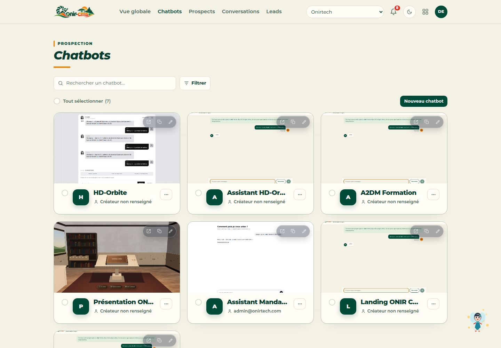
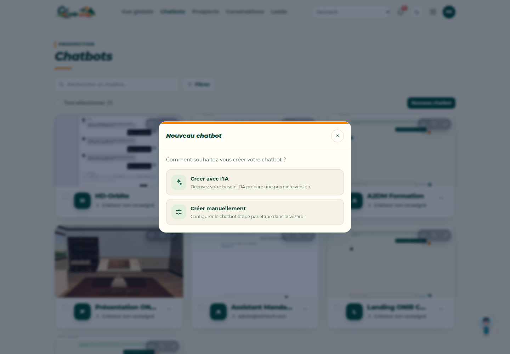
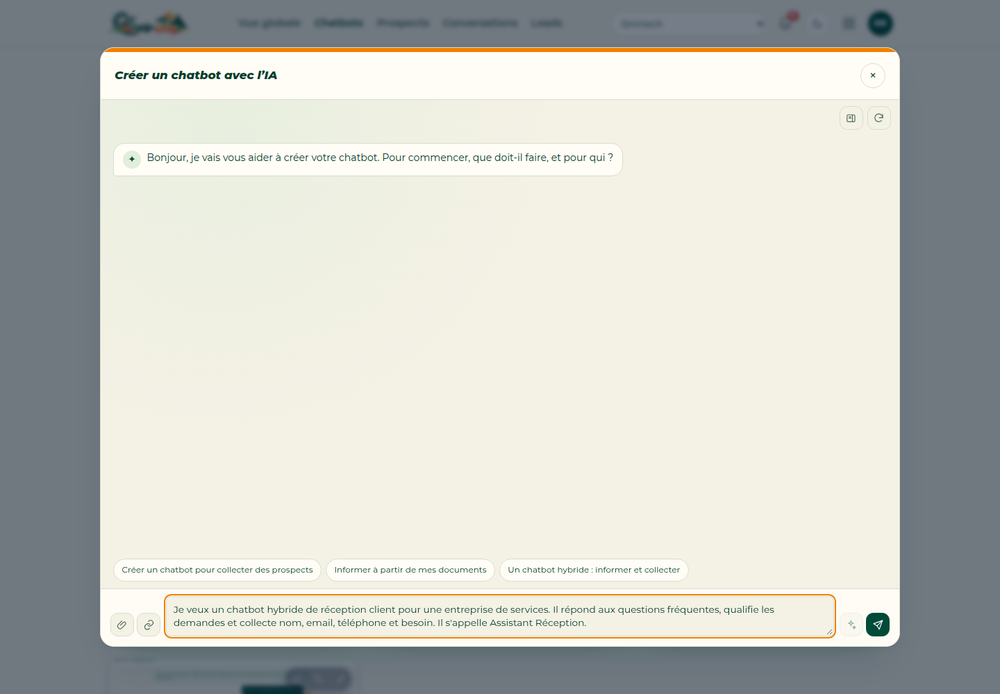
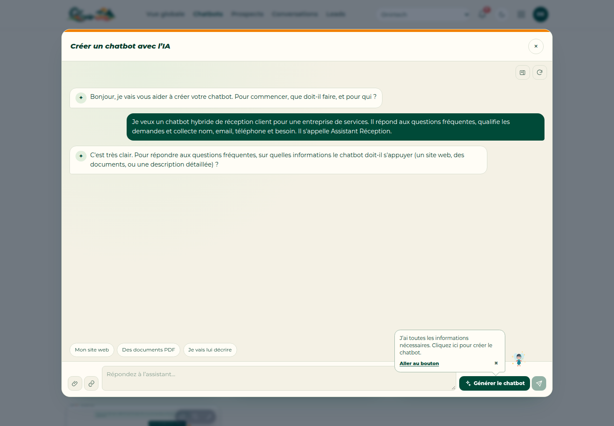
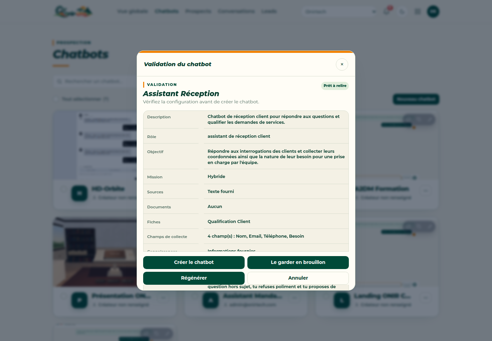
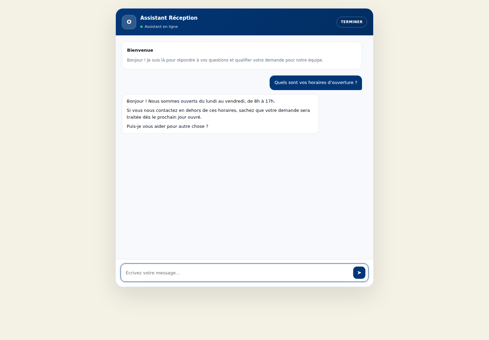

Créer un chatbot utile ne demande pas forcément de commencer par la configuration technique. Avec l’assistant IA d’ONIR-CMS, vous décrivez votre besoin en langage naturel, puis l’IA prépare une première version du chatbot : rôle, objectif, sources, champs de collecte et template.

Dans ce tutoriel, nous allons créer un **assistant de réception client** pour une entreprise de services. Il devra répondre aux questions fréquentes, qualifier les demandes et collecter les coordonnées utiles.

## Étape 1 — Ouvrir la création d’un chatbot

Depuis **Chatbots**, cliquez sur **Nouveau chatbot**.

## Étape 2 — Choisir la création avec l’IA

Sélectionnez **Créer avec l’IA**. L’assistant vous guide par une conversation, sans vous demander de remplir immédiatement tous les réglages.

## Étape 3 — Décrire le besoin

Expliquez simplement ce que doit faire le chatbot et à qui il s’adresse. Voici le brief utilisé pour cet exemple :

> Je veux un chatbot hybride de réception client pour une entreprise de services. Il répond aux questions fréquentes, qualifie les demandes et collecte nom, email, téléphone et besoin. Il s’appelle Assistant Réception.

## Étape 4 — Laisser l’IA préciser la configuration

L’assistant reformule le besoin et vérifie les points importants : mission hybride, sources d’information et informations à collecter. Vous pouvez répondre par les propositions rapides ou préciser votre contexte.

## Étape 5 — Vérifier avant de créer

Cliquez sur **Générer le chatbot**, puis sur **Créer le chatbot**. ONIR-CMS affiche un récapitulatif : description, rôle, objectif, mission, sources, fiches et champs de collecte. C’est le moment de vérifier que tout correspond à votre besoin.

## Étape 6 — Le chatbot est prêt

Après validation, le chatbot apparaît dans la liste avec son URL et son aperçu. Il ne reste plus qu’à le tester, l’ouvrir ou copier son lien.

## Résultat

En moins de cinq minutes, nous avons obtenu un assistant capable de :

- répondre aux questions fréquentes ;
- qualifier une demande ;
- collecter le nom, l’email, le téléphone et le besoin ;
- préparer une fiche de qualification pour la reprise humaine.

L’assistant IA ne remplace pas la validation métier : il prépare une base solide que vous pouvez ajuster dans l’éditeur avant la mise en production.
