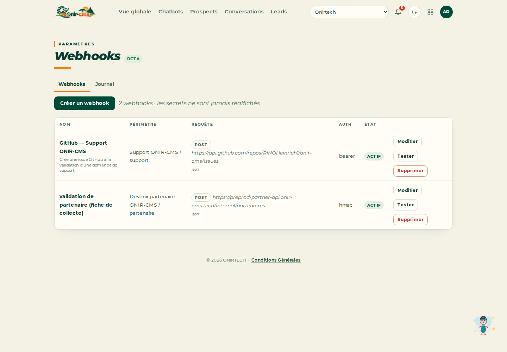
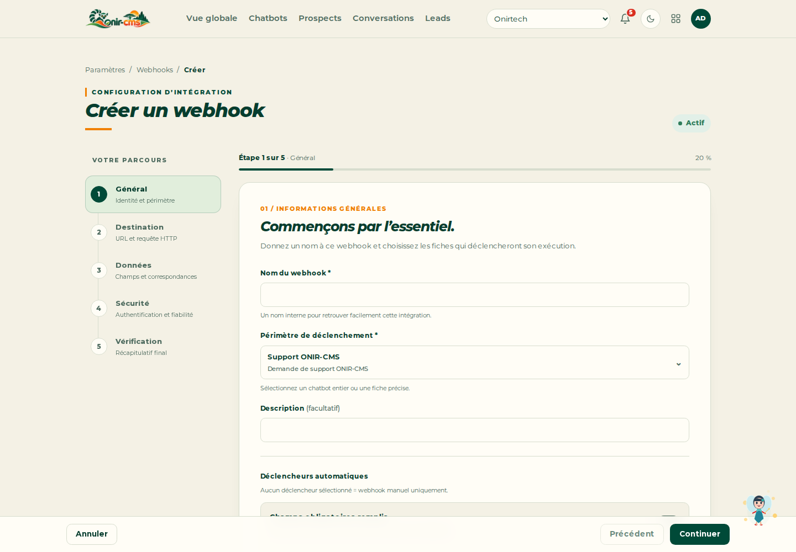
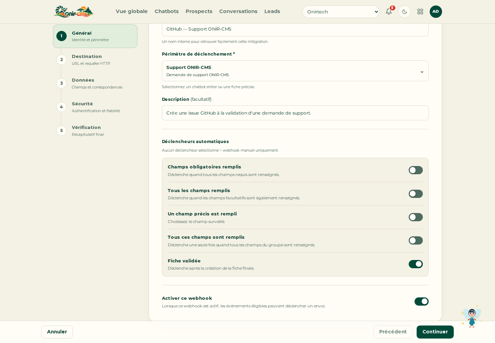

Un webhook transforme une simple fiche en un déclencheur pour vos outils externes. Concrètement, une demande de devis peut bloquer un créneau dans votre agenda, un incident peut ouvrir un ticket d’intervention, une candidature créer un dossier RH, une commande réserver du stock ou encore une visite préparer un badge d’accès.

Le mécanisme est toujours le même : dès qu’une fiche passe à un statut précis, ONIR-CMS notifie une API externe qui se charge d’exécuter l’action.

Les chatbots ONIR-CMS étant capables de remplir des fiches, cela enrichit énormément les possibilités.

Dans ce tutoriel, nous allons voir comment fonctionne cette logique. Nous utiliserons un outil concret pour la démonstration finale, mais vous pourrez ensuite appliquer ce principe à n’importe quel autre service.

> Les webhooks sont actuellement en **Beta**. Le parcours est fonctionnel, mais l’interface et les options peuvent encore évoluer.



## Comprendre le mécanisme

Un webhook repose sur quatre éléments :

1. **une fiche** : les données collectées pendant la conversation ;
2. **un événement** : la transition qui doit déclencher l’action ;
3. **une destination** : l’API qui recevra la requête ;
4. **un payload** : les données envoyées à cette API.

Le webhook est rattaché à une fiche, pas directement à un chatbot. Cela permet de déclencher l’intégration uniquement pour les fiches concernées.

```text
Conversation
  → fiche enrichie
  → événement métier
  → outbox
  → dispatcher
  → livraison HTTP
  → service extérieur
```

L’appel HTTP n’est jamais exécuté dans le tour de chat. La réponse au visiteur n’attend donc pas le service extérieur, et les tentatives peuvent être rejouées.

## 1. Préparer la fiche

La fiche doit contenir les informations dont votre destination a besoin.

Prenons une fiche de support :

- sujet ;
- description détaillée ;
- catégorie ;
- email de contact ;
- nom, facultatif.

Une fiche trop pauvre produira un webhook inutilisable. Une fiche bien structurée permettra de construire un payload clair.

## 2. Créer le webhook

Dans **Paramètres → Webhooks**, cliquez sur **Créer un webhook**.

Renseignez :

- un nom interne ;
- le périmètre : chatbot entier ou fiche précise ;
- une description facultative.



Le nom sert uniquement à retrouver l’intégration. Le périmètre détermine les fiches qui pourront déclencher ce webhook.

## 3. Choisir le déclencheur

Un déclencheur décrit une **transition**, pas un état permanent.

Les événements disponibles sont :

| Déclencheur | Quand se déclenche-t-il ? |
| --- | --- |
| Champs obligatoires remplis | Tous les champs obligatoires de la fiche sont renseignés |
| Tous les champs remplis | Tous les champs, facultatifs inclus, sont renseignés |
| Un champ précis est rempli | Un champ choisi passe de vide à rempli |
| Tous ces champs sont remplis | Tous les champs d’un groupe choisi sont remplis |
| Fiche validée | La fiche finale est créée après validation |

`Un champ précis` se comporte comme un **OU** si plusieurs champs sont surveillés séparément. `Tous ces champs` se comporte comme un **ET** sur un groupe.



Sans déclencheur, le webhook reste **manuel** et peut toujours être lancé depuis une fiche.

## 4. Configurer la destination

Indiquez :

- l’URL de l’API ;
- la méthode HTTP ;
- le format du corps ;
- les éventuels paramètres de query et en-têtes.

Exemple de destination :

```text
POST https://api.exemple.com/evenements/support
```

Pour les services qui le demandent, choisissez une authentification :

- Bearer token ;
- Basic auth ;
- clé API dans un en-tête ou la query ;
- signature HMAC ;
- OAuth2 client credentials.

Les secrets sont chiffrés et ne sont jamais réaffichés après enregistrement.

## 5. Construire le payload

Deux approches sont possibles :

- **mappings de champs** : vous associez des champs de la fiche à des clés cibles ;
- **template JSON personnalisé** : vous composez le corps avec des placeholders.

Exemple générique :

```json
{
  "subject": {{sujet}},
  "message": {{description}},
  "category": {{categorie}}
}
```

Avec le mode JSON, les valeurs sont sérialisées par ONIR-CMS. Un texte contenant des guillemets ou des retours à la ligne ne casse pas le JSON.

Avant d’activer un webhook automatique, vérifiez que tous les mappings marqués requis sont garantis par le déclencheur choisi.

## 6. Tester et surveiller

L’écran de configuration permet de tester l’endpoint. Le journal des webhooks conserve :

- le statut de la livraison ;
- le code HTTP ;
- les tentatives ;
- les erreurs éventuelles.

Un webhook peut être actif mais échouer côté destination. Le journal reste la source de vérité pour diagnostiquer l’intégration.

## Quelques scénarios concrets

Le même mécanisme peut piloter des actions très différentes.

### Atelier et maintenance

Une fiche d’intervention validée peut créer un ordre de travail dans une GMAO, réserver une pièce dans le stock et affecter un technicien selon ses compétences.

Payload possible :

```json
{
  "site": "Atelier Nord",
  "intervention": "Remplacement presse hydraulique",
  "priority": "haute"
}
```

### Logistique

Une demande d’expédition validée peut être envoyée à un TMS pour calculer un itinéraire, réserver un créneau de quai et générer une étiquette transporteur.

### Finance et achats

Une note de frais ou une demande d’achat peut créer une écriture dans l’ERP, déclencher un contrôle de conformité ou préparer un virement.

### Éducation

Une inscription validée peut ouvrir un compte dans un LMS, réserver une place dans un groupe et générer un badge étudiant.

### Collectivité et terrain

Un signalement validé peut créer une intervention géolocalisée dans un SIG, affecter une équipe et envoyer la position au système de suivi des véhicules.

### Industrie

Un contrôle qualité peut bloquer un lot dans un MES, imprimer une étiquette de quarantaine et notifier la chaîne de production.

Dans chaque cas, seuls changent :

- la destination ;
- l’authentification ;
- le format du payload ;
- les champs réellement utiles.

## Démonstration : GitHub comme destination

Pour rendre le parcours concret, nous utilisons GitHub comme destination de démonstration. Rien dans le mécanisme n’est spécifique à GitHub.

```text
POST https://api.github.com/repos/{owner}/{repo}/issues
```

Authentification : **Bearer token** GitHub.

En-têtes utiles :

```text
Accept: application/vnd.github+json
X-GitHub-Api-Version: 2022-11-28
```

Template JSON :

```json
{
  "title": {{sujet}},
  "body": {{description}},
  "labels": ["support"]
}
```

Le sujet devient le titre de l’issue, la description son contenu, et le label permet de retrouver les demandes.

Lors du test préprod, la validation d’une fiche a créé une issue réelle avec le label `support`.


## Bonnes pratiques

- choisir le déclencheur le plus proche du besoin métier ;
- ne pas déclencher sur un état instable ou transitoire ;
- limiter les mappings au strict nécessaire ;
- tester avant d’activer ;
- surveiller le journal ;
- utiliser un secret dédié et le révoquer en cas de doute ;
- garder la destination idempotente : un rejeu ne doit pas créer deux actions métier.

## À retenir

Un webhook est un **pont entre une fiche et une action extérieure**.

La qualité de l’intégration dépend moins du service destinataire que de trois choix :

1. le bon événement ;
2. le bon périmètre ;
3. le bon payload.

GitHub était ici un exemple de destination. Le mécanisme reste générique : toute API peut être connectée de la même manière.
