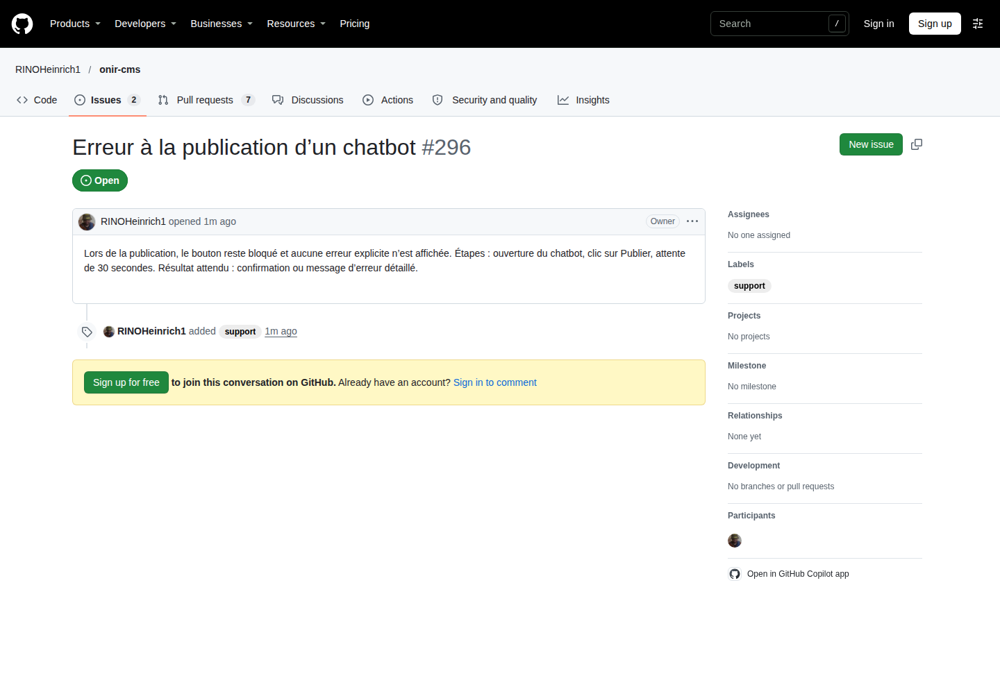

Les webhooks permettent à ONIR-CMS de prévenir un service extérieur lorsqu’une fiche atteint un état métier précis. Dans ce tutoriel, nous utilisons ce mécanisme pour **créer automatiquement une issue GitHub** à partir d’une demande de support.

Le scénario reprend le chatbot **Support ONIR-CMS** : le visiteur décrit son problème, l’IA organise les informations dans une fiche, puis la validation de cette fiche déclenche le webhook.

> Les webhooks sont actuellement en **Beta**. Le parcours est fonctionnel, mais l’interface et les options peuvent encore évoluer.


## 1. Préparer la fiche

La fiche doit contenir les informations utiles au ticket :

- sujet ;
- description détaillée ;
- catégorie ;
- email de contact ;
- nom, facultatif.

Le webhook sera rattaché à cette fiche, pas directement au chatbot. Cela permet de déclencher l’intégration uniquement pour les demandes de support concernées.

## 2. Créer le webhook

Dans **Paramètres → Webhooks**, cliquez sur **Créer un webhook**.

Renseignez :

- un nom interne, par exemple `GitHub — Support ONIR-CMS` ;
- le périmètre : le chatbot Support ONIR-CMS et la fiche `support` ;
- une description facultative.


## 3. Choisir le déclencheur

Les déclencheurs disponibles sont :

- **Champs obligatoires remplis** ;
- **Tous les champs remplis** ;
- **Un champ précis est rempli** ;
- **Tous ces champs sont remplis** — condition ET sur un groupe ;
- **Fiche validée**.

Pour notre scénario, nous choisissons **Fiche validée** : l’issue ne doit être créée qu’après la validation finale de la demande.


> Un webhook sans déclencheur reste manuel. Il peut toujours être lancé depuis sa fiche.

## 4. Configurer GitHub

Destination :

```text
POST https://api.github.com/repos/RINOHeinrich1/onir-cms/issues
```

Authentification : **Bearer token** GitHub.

En-têtes utiles :

```text
Accept: application/vnd.github+json
X-GitHub-Api-Version: 2022-11-28
```

Le token est chiffré en base et n’est jamais réaffiché après enregistrement.

## 5. Construire le corps de l’issue

Avec le format **JSON**, le template peut utiliser les champs de la fiche :

```json
{
  "title": {{sujet}},
  "body": {{description}},
  "labels": ["support"]
}
```

Les valeurs sont sérialisées par ONIR-CMS : un sujet ou une description contenant des guillemets ne casse pas le JSON.

Le sujet devient le titre de l’issue, la description devient son contenu, et le label `support` permet de retrouver les demandes.

## 6. Tester avant de valider

L’écran de configuration permet de tester l’endpoint avant de compter sur le déclenchement automatique. Le journal des webhooks conserve les tentatives, les statuts HTTP et les erreurs.

Une fois le webhook actif, le parcours est le suivant :

```text
Conversation
  → fiche enrichie
  → validation finale
  → événement fiche.validated
  → outbox
  → dispatcher
  → livraison HTTP
  → issue GitHub
```

L’appel HTTP n’est pas exécuté dans le tour de chat : la réponse au visiteur n’attend pas GitHub.

## 7. Résultat

Lors du test préprod, la validation de la fiche a créé une issue réelle avec le label `support`.



## À retenir

- le webhook est rattaché à une **fiche** ;
- le déclencheur décrit une **transition métier**, pas un simple clic ;
- `field_filled` surveille un champ, `fields_filled` attend un groupe de champs ;
- le token GitHub est chiffré ;
- le test et le journal permettent de vérifier l’intégration avant de l’activer en production.
